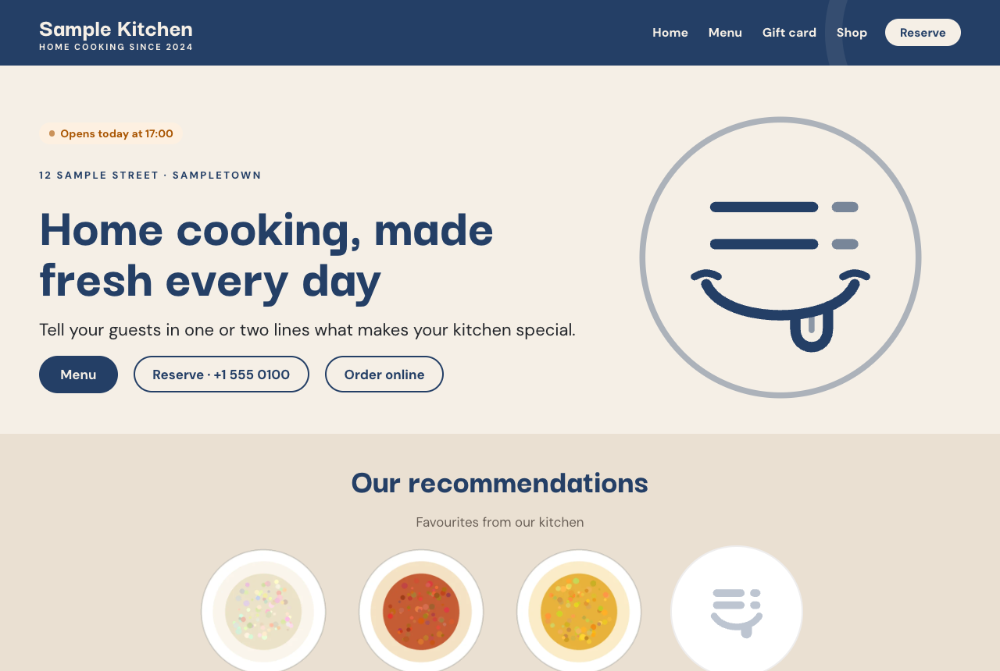
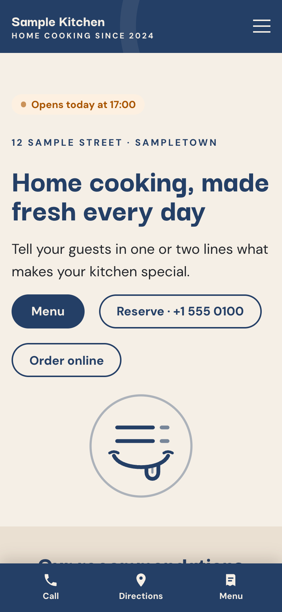
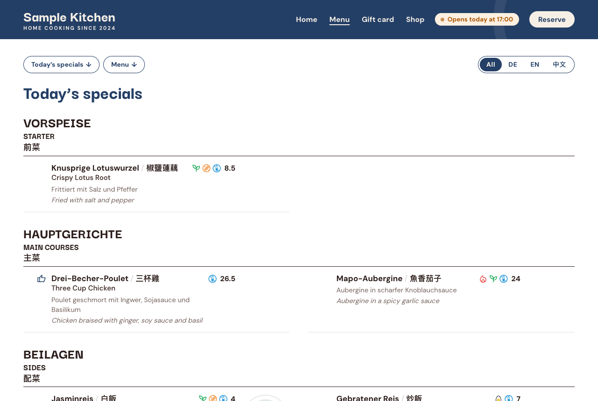
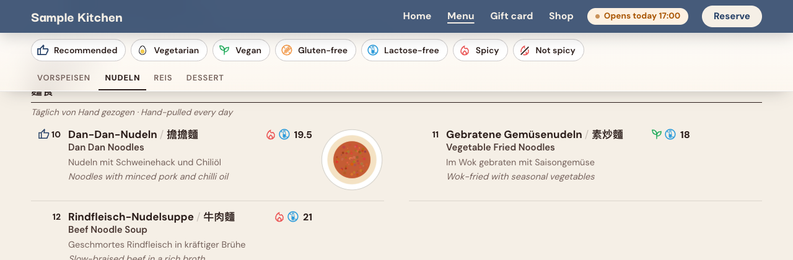
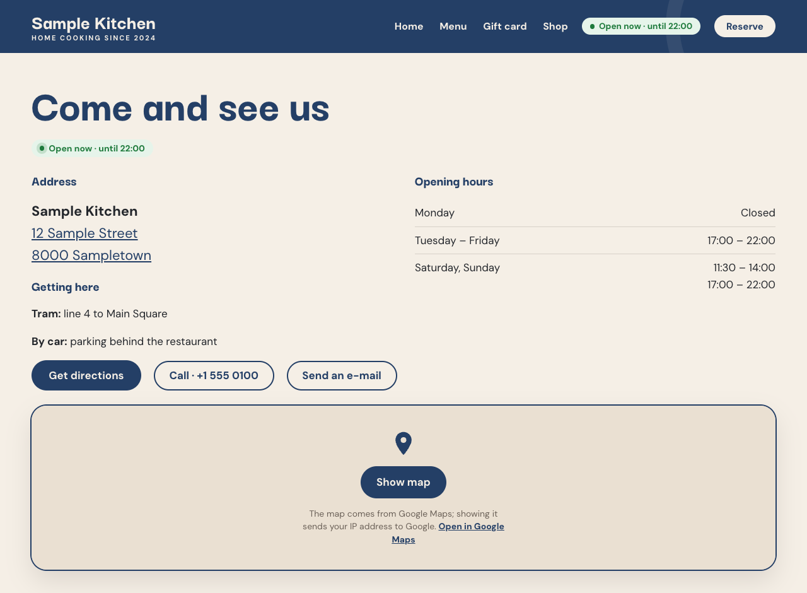
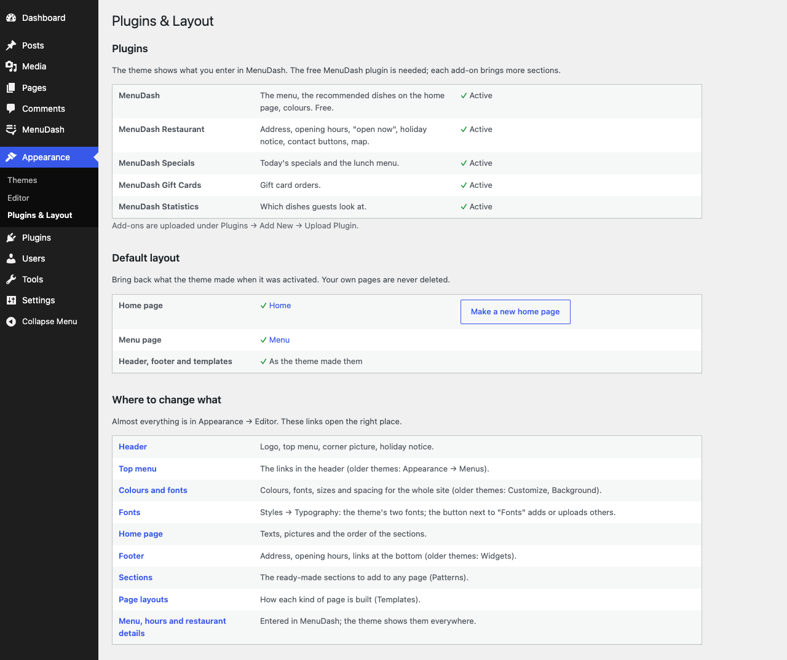
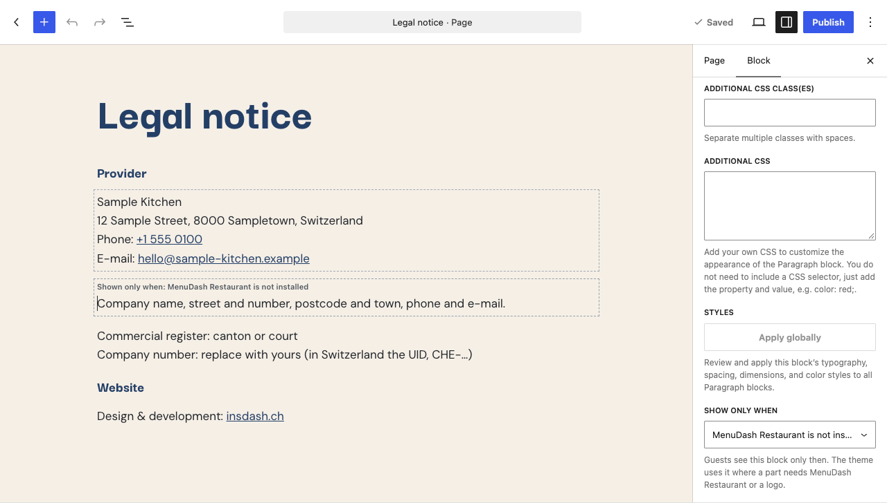
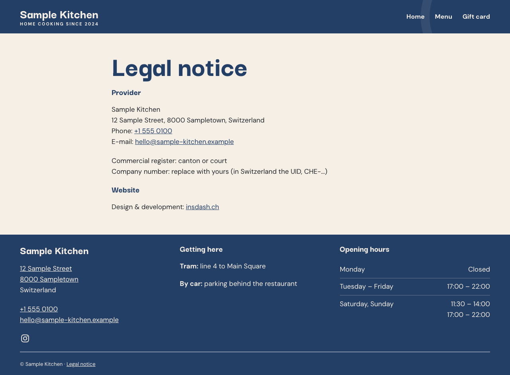
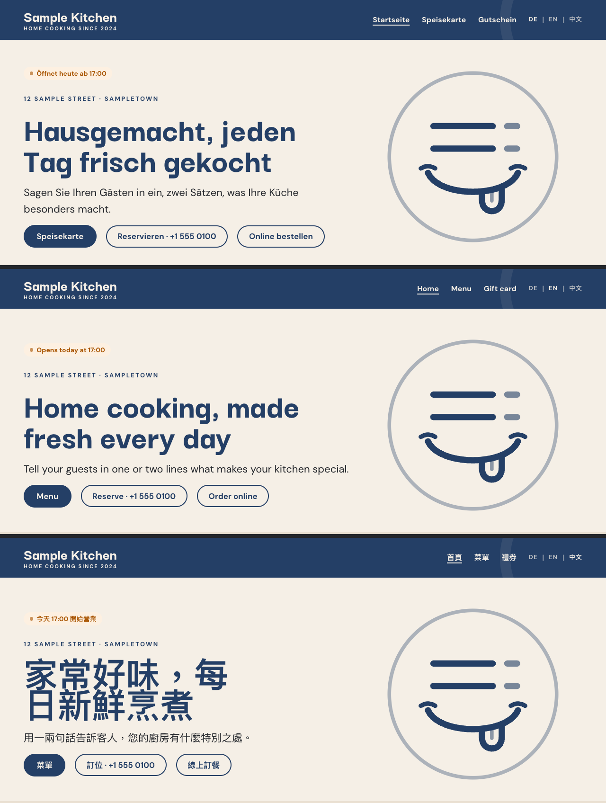

# MenuDash Theme

A restaurant website theme for WordPress, made for the **[MenuDash](https://github.com/yingshiuan/menudash)** plugin.

MenuDash holds everything the restaurant keeps up to date: the menu, today's specials, opening hours and holidays, gift cards and the restaurant's details (address, phone, delivery link and times, social links). This theme shows all of it in a warm, simple design, so the owner never edits the same phone number in two places.

 



## What's on the home page

| Section | Where its content comes from |
|---|---|
| Welcome: headline, "Open now · until 22:00", buttons *Menu · Reserve · Order online* | the text and buttons in the editor; the badge, and the reserve and order links, from MenuDash |
| Our recommendations | MenuDash's *Recommended dishes* block: the dishes marked **Recommended** in the menu, or the ones chosen in its sidebar, optionally in groups (tabs), with their photos |
| What guests say | a quote you type in the editor |
| About us | your text, and the Instagram button from MenuDash |
| Gift card | shows by itself while MenuDash takes gift card orders |
| Visit us / Delivery, with a map | address, phone, getting here, delivery link and ordering times from MenuDash; the map loads only after a click |
| Footer | address (opens Google Maps), phone and e-mail, social icons (each link entered under MenuDash → Restaurant: Instagram, Facebook, Google, Tripadvisor, TikTok, YouTube, WhatsApp), getting here, opening hours, "© Company · Legal notice · Privacy · meat origin" (each link once its page exists; the last one is the published page with MenuDash's `[menudash_origin]`, e.g. *Fleisch-Deklaration*) |

**The header** stays at the top: at the start of a page it's the coloured band with the logo, tagline and menu; once the guest scrolls, it becomes a slim bar in frosted glass (smaller logo, no tagline), slides away while scrolling down and comes back when scrolling up. On wide screens (from 1280 pixels) it also has **Reserve** as a pill button and the "Open now" badge (with MenuDash Restaurant; on the home page the badge joins once the hero's own badge is scrolled away). On the menu page, MenuDash's filter bar sits right under it.



On phones a floating bar in frosted glass offers **Call · Directions · Menu**; it slides away while guests scroll down to read and comes back when they scroll up. On the menu page, the filter and category bar turns to the same glass once it sticks to the top, and with MenuDash's guest selection the + buttons and the back-to-top button match it. The menu page (any page with `[menudash]`) gets a wide layout by itself: the lunch menu (today, with the whole week one tap away) and today's specials above the menu, jump buttons with one language switch at the top, and a back-to-top button while reading the menu.

Pages with another MenuDash part (gift card form, shop, opening hours, contact, a pattern made of them) get the same width as the menu by themselves, without the specials; pages of plain text, such as the legal notice, keep a narrower, easy-to-read column. A layout you pick for a page in the editor always wins (*Wide page (menu)*, *Wide page (gift card, shop, visit us)*).

**Visit us page:** the pattern *Visit us page with the map* fills a whole page: "Open now", the address (a tap opens Google Maps), getting here, the buttons *Get directions*, *Call · your number* and *Send an e-mail* in one row, the opening hours with lines between the days, and the map. Everything comes from MenuDash → Restaurant and Hours & holidays.



**Not found (404):** a page that doesn't exist shows a big "404" with the restaurant's Site Icon as the 0 (drawn round; the theme's smile when there is no icon; in the editor it's the block *404 number*, where *The 0* can also be the smile or an own picture), "This page is not on the menu" and buttons to the menu and the home page.

## Install

1. Install and activate **MenuDash** 2.4 or later first (see its [releases](https://github.com/yingshiuan/menudash/releases); 2.1 works too, but then the recommendations can't be chosen or grouped, and the menu keeps the theme's fonts when you change them in Styles only from 2.4). The theme works with MenuDash alone. The sections with the restaurant's address, opening hours, "open now" badge, holiday notice and contact buttons need the **MenuDash Restaurant** add-on, the specials and lunch-menu sections **MenuDash Specials** (1.1 for the lunch menu), and the gift card page **MenuDash Gift Cards** (see [MenuDash → Add-ons](https://github.com/yingshiuan/menudash#add-ons)). Without an add-on its parts simply stay empty. Installed the theme first? While MenuDash is missing, the Dashboard, Themes and Plugins screens show an **Install and activate MenuDash** button (from 1.10.0): it installs the latest release from GitHub, and the theme then makes the Menu page by itself. The paid add-ons are installed by hand. **Appearance → Plugins & Layout** shows MenuDash and each add-on (active, installed or missing, with a button), and brings back the default layout: a new Home page with the theme's sections (the old one stays under Pages), the Menu page, and the header, footer and templates as the theme made them (changes made in the Editor go to the bin).
2. Download `menudash-theme.zip` from this repository's [releases](https://github.com/yingshiuan/menudash-theme/releases), then *Appearance → Themes → Add New Theme → Upload Theme*, and activate it.
3. On activation the theme makes a **Home** page from its sections and sets it as the front page (a site with a front page already keeps it; the sections are then in the block inserter under *Restaurant (MenuDash)*), and a **Menu** page (*Speisekarte* on a German site) with the menu, unless a page with `[menudash]` exists already.
4. Upload your menu, and with MenuDash Restaurant fill in **MenuDash → Restaurant** (address, phone, delivery …) and **MenuDash → Hours & holidays**.
5. Add your logo under *Appearance → Editor* (the header shows the site title until then), and build the top menu under *Appearance → Editor → Navigation*.

Requires WordPress 6.5+ and PHP 7.4+.



## Editing

It's a block theme: *Appearance → Editor* for the header, footer and templates, *Styles* for colours and fonts (dark blue on beige by default, plus three colour sets: *Terracotta*, *Olive* and *Midnight*), and *Pages → Home* for the home page's texts.

Parts with a thin dashed outline in the editor come from MenuDash (address, phone, delivery, map, the footer's contact lines). They are drawn fresh on every page view, so saving a page never freezes old details into it: change them in MenuDash, not in the editor. The theme's own blocks are in the inserter under *MenuDash Theme*; *Open now*, *Opening hours* and *Contact* (address, phone, e-mail, getting here — choose the parts in its sidebar) are MenuDash's blocks, under *MenuDash*. The home page is made of sections: to change the badge, an address line or the buttons inside one, click **Edit pattern** first.

**Corner picture:** the faint drawing in the header's right corner. Select the header's coloured band in *Appearance → Editor* and choose under *Corner picture*: *Automatic* (your icon from MenuDash → Restaurant, otherwise a ring), *Ring*, *Own picture* or *No picture*, and how strong it shows.

**Show only when:** some parts depend on MenuDash Restaurant or a logo: the footer's address and hours, the *Reserve* and *Order online* buttons, the legal notice's placeholder, the logo or the site's name in the header. The theme keeps both versions and shows the one that fits on every page view, also after you save the page or template in the editor. Those blocks have a thin dashed outline and a label in the editor (*Shown only when: MenuDash Restaurant is active*). Any block can get this: select it and choose under *Advanced → Show only when*.



The buttons are WordPress's own: delete, reorder or add one with any link (your booking or order system). *Reserve*, *Order online* and *Get directions* take their links from **MenuDash → Restaurant** and hide when that detail is empty; *Reserve* opens the **Reservation link** if you entered one, otherwise it calls. More such buttons: inside a Buttons block, *Reserve / Order online / Call / Directions (MenuDash)*.

Leave the order link empty, or delete the delivery block, and the visit column takes the whole width.

**Google and shared links:** the theme gives each page a short description (the site's tagline, or the page's excerpt) and the site icon as the picture shown when a link is shared. With **MenuDash Restaurant 1.5** or newer, MenuDash does this better (*Restaurant → Google → Search and sharing*: descriptions in every language, share pictures made from your dish photos), and the theme leaves it to MenuDash. With an SEO plugin (Yoast, Rank Math …), neither adds its own.

**Legal notice** (*Impressum*; in Switzerland and Germany a website that sells something must say who runs it): make a page *Legal notice* with the address `legal-notice` (`impressum` on a German site) and insert the pattern *Legal notice*. It shows your company, address, phone and e-mail from MenuDash → Restaurant; fill in your commercial register and company number. The footer links to the page once it is published.



## Languages

The theme is written in English and includes German (`de_DE`, and `de_CH` with "ss") and Traditional Chinese (`zh_TW`, `zh_HK`), the same three languages as MenuDash. WordPress picks the language from *Settings → General → Site Language*. To add another, translate `menudash-theme/languages/menudash-theme.pot` (e.g. with Poedit) and save the files as `languages/<locale>.po` and `.mo`.

## Two or more languages (Polylang)

The theme is in English, German and Traditional Chinese, following *Settings → General → Site Language*. For a site in two or more languages at once, with a switch for guests, use the free **[Polylang](https://wordpress.org/plugins/polylang/)** plugin:



1. Install Polylang and add the languages under *Languages* (e.g. German first, then English).
2. Under *Languages → Settings → URL modifications*, tick **"The front page URL contains the language code instead of the page name or page id"**, so the English home page is `/en/`.
3. Save *Settings → Permalinks* once (otherwise `/en/…` shows "Page not found").
4. Translate each page (Home, Menu, Gift card …) with the **+** in the Pages list. Give each its address in its own language, e.g. `/speisekarte/` and `/en/menu/`, `/gutschein/` and `/en/gift-card/` (the free Polylang can't use the same address twice; on a German site the theme already makes the menu page at `/speisekarte/`).

The theme does the rest by itself:
- The header's navigation stays one for all languages. Each link to a page goes to that page's translation, under the translated title, and the languages (**DE | EN | 中文**) are added at the end (also in the phone menu). If you add Polylang's own language switcher to the navigation, the theme leaves it to that one.
- Its texts and MenuDash's (buttons, opening hours, "open now", address labels, gift card form, recommended dishes) follow the language of the page, and the *Menu* buttons go to the menu page in that language.

The menu itself needs no translated page: MenuDash shows German, English and Chinese on one page, with its own switch.

## For developers

```sh
dev/serve.sh              # a local WordPress with MenuDash and its sample menu: http://127.0.0.1:9402
dev/serve.sh 9403 de      # the same in German
dev/build-zip.sh          # dist/menudash-theme.zip
```

`serve.sh` downloads MenuDash into `dev/.cache` the first time (or uses `MENUDASH_DIR`). It needs Node.js; WordPress runs in [WordPress Playground](https://wordpress.org/playground/). Wait until it prints "Ready!", then open the address. You're logged in automatically; otherwise log in at `/wp-admin/` with `admin` / `password`. Stop it with Ctrl+C. The site is fresh at every start: changes made in the dashboard are gone after a restart.

The theme's MenuDash blocks are in `menudash-theme/inc/blocks.php` (`menudash-theme/delivery`, `map`, `social`, `picks`, `giftcard` …; `open`, `buttons`, `place`, `contact` and `directions` are only kept for pages saved with earlier versions). They read MenuDash with `mdash_detail()`, `mdash_hours()` and the menu data, and print nothing without MenuDash. `menudash-theme/not-found` is the 404 page's number. Every block can carry the attribute `mdtShow` (`restaurant`, `no-restaurant`, `logo`, `no-logo`; several separated by commas must all be true): the block is left out of the page when it doesn't hold. The editor's live previews show both versions; everything else, the REST API included, gets what guests see.

The theme puts the page's stylesheets (its own, MenuDash's and the core blocks') into the page instead of loading them as separate files, so phones draw the page sooner. If a caching or optimising plugin already combines them, keep separate files with `add_filter( 'menudash_theme_inline_styles', '__return_false' );`.

## Licence

GPL-2.0-or-later, like WordPress. The fonts, DM Sans and Darker Grotesque, are under the SIL Open Font License (see `menudash-theme/assets/fonts`).

Made by [insdash](https://insdash.ch), which also sets up MenuDash and its add-ons for restaurants.
